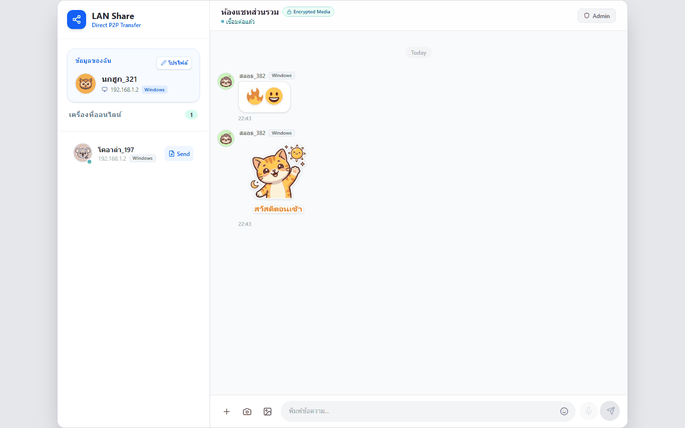
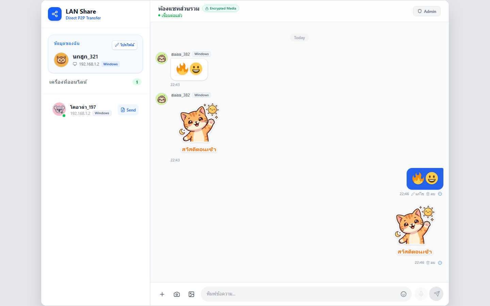
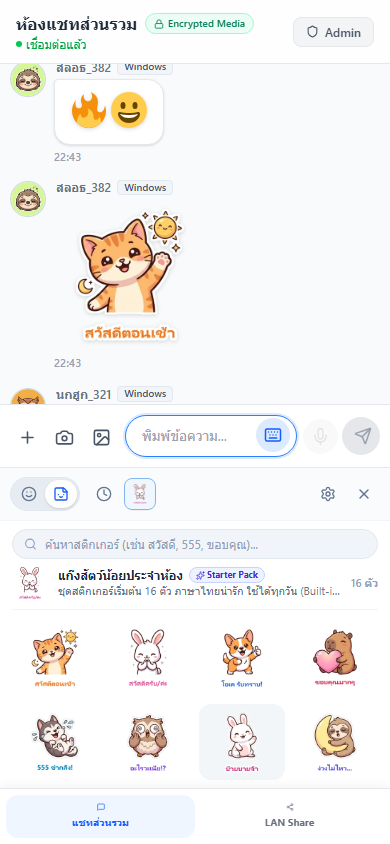
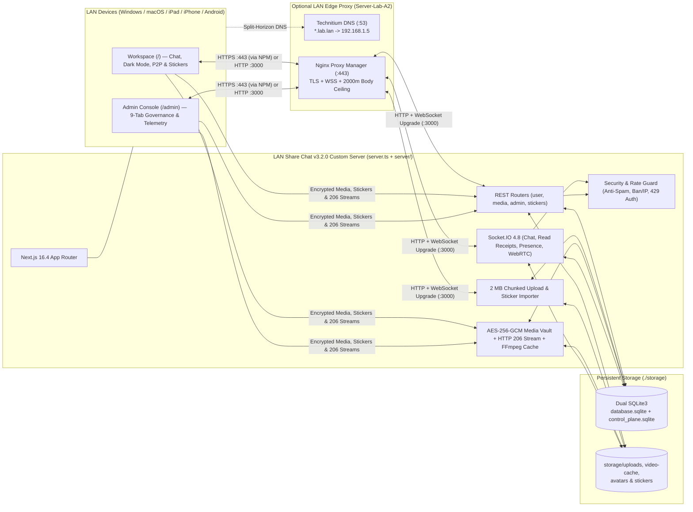

# LAN Share Chat v3.2.0

A self-hosted group chat and direct peer-to-peer (P2P) file sharing workspace built for local networks (LAN). It runs 100% offline without external cloud services, featuring **WebRTC DataChannel P2P transfers**, an **AES-256-GCM encrypted media vault**, a **Sticker Collage Studio**, and a **9-tab Admin Governance Console**.

[](https://rathanon-lab.github.io/lan-share-chat/)
[](https://nextjs.org/)
[](https://www.typescriptlang.org/)
[](https://socket.io/)
[](https://www.sqlite.org/)
[](Dockerfile)
[](LICENSE)

> **🌐 Try the Live Browser Prototype:** [**https://rathanon-lab.github.io/lan-share-chat/**](https://rathanon-lab.github.io/lan-share-chat/)  
> *Runs entirely in browser RAM (`0` external requests, `0` real file uploads). Includes a top switcher bar to test **Desktop**, **iPad**, and **Mobile** viewports, simulated P2P transfers with 3 online peers, sticker collages, and the full 9-tab Admin Console (no password required in demo mode).*

---

## Live Interactive Walkthroughs

| Chat, Unified Twemoji & Shared Stickers | Direct WebRTC P2P & Secure Relay | Admin Governance & Visual Vault |
| :---: | :---: | :---: |
|  |  |  |
| Offline Twemoji SVG picker, 16-item Thai animal sticker pack, Pre-Send Preview & Sticker Collage Studio | Automatic LAN peer discovery, direct WebRTC chunked transfer, and 3.5s Relay failover | 9-Tab Admin Console with Overview Telemetry, Visual Media Vault, Batch Moderation & Sticker Studio |

### Multi-Viewport Snapshots

| Desktop (`1440×900`) | iPad Landscape (`1024×768`) | Mobile Portrait (`390×844`) | Admin Visual Media Vault (`/admin?tab=files`) |
| :---: | :---: | :---: | :---: |
|  |  |  |  |

---

## Core Highlights

### 1. Group Chat & Expressive Media (`/`)
- **Zero-Signup Animal Identities:** Every device joining the LAN automatically receives an unused animal alias, a circular avatar (`20+1` presets or custom cropped upload), and an OS badge (`Windows`, `macOS`, `iPad`, `iPhone`, `Android`, `Linux`).
- **Offline Twemoji & Sticker Collage Studio:** Self-hosted Twemoji SVGs render identically across every OS. Includes a 16-sticker Thai office mascot pack (`แก๊งสัตว์น้อยประจำห้อง`), dual pre-send preview modes (Full-Screen Zoom or Docked Tray), and an interactive **Sticker Collage Studio** to combine, scale, and rotate up to 6 stickers on one canvas.
- **Responsive Ultrawide, Mobile & Dark Mode UI:** Adapts cleanly from mobile portrait (`390×844`) and iPad split-view up to ultrawide desktop monitors, with instant **Thai / English (`TH / EN`)** and **Dark Mode (`🌙 / ☀️`)** toggles.
- **In-App Rich File Previews:** View images (with pinch-to-zoom & `90°` rotation), `.mp4`/`.mov` videos (`HTTP 206` byte-range streaming), voice notes, `PDF`, `DOCX`, `Markdown`, `ZIP` trees, and Apple `HEIC` photos directly in the browser without downloading raw files first.

### 2. Direct WebRTC P2P & Encrypted Vault
- **Direct WebRTC DataChannel + 3.5s Relay Failover:** Click **`Send`** next to any online peer to stream files peer-to-peer in `16 KB` SCTP chunks with backpressure control. If a strict VLAN blocks direct WebRTC handshake, it falls back automatically within `3.5 seconds` to an ACK-controlled Socket.IO Secure Relay (`32 KB` chunks).
- **1 GB Chunked Uploads:** Large files (`> 2 MB`) and multi-file batches upload via resumable `2 MB` binary chunks (`MAX_CHAT_FILE_SIZE_MB=1024`).
- **AES-256-GCM Encrypted Storage:** Uploaded room files are encrypted at rest (`storage/uploads/`) and served only through authenticated tokens and a bounded FFmpeg/WebP thumbnail worker queue.

### 3. 9-Tab Admin Governance Console (`/admin`)
- **Overview & Live Room Controls:** Monitor server uptime, 24-hour concurrency charts, and 30-day traffic summaries. Toggle **Spotlight Hold**, **Freeze Public Chat**, **Privacy Blur**, or **Anti-Spam Firewall** in real time.
- **Moderation, Alerts & Visual Vault:** Batch-delete messages, run surgical time-range or bot-spam purges, resolve `@admin` mentions and delete requests, and browse all uploaded media in a Netflix-style windowed grid or list view with macOS Finder-style filmstrip preview.
- **Device Governance, Sticker Studio & `.env` Audit:** Mute or ban disruptive devices/IPs, import or edit `.zip` sticker packs live, inspect the 90-day Activity Log, and audit storage quotas across all 6 isolated disk zones (`db`, `uploads`, `stickers`, `avatars`, `cache`, `chunks`).

<details>
<summary><strong>🛠️ What's New in v3.2.0 — Engineering & Performance Notes (Click to expand)</strong></summary>

<br/>

Full release notes: [`RELEASE_NOTES_v3.2.0.md`](RELEASE_NOTES_v3.2.0.md)

- **Dual-SQLite Bulkhead (`database.sqlite` + `control_plane.sqlite`) & `0.1ms` Emergency Gate:** Separates write-heavy chat/media traffic from admin control state so emergency governance actions (`Spotlight`, `Lock Chat`, `Privacy Blur`) execute in `~10ms` even under heavy upload floods.
- **Dynamic Adaptive Media Worker Queue (`MEDIA_WORKER_CONCURRENCY=auto`):** Auto-detects container/host CPU cores and free RAM with `< 15%` memory backpressure for thumbnail and FFmpeg jobs.
- **Persistent Viewport Gate & Auto-Dynamic LRU Blob Cache:** Unmounts off-screen media and animated `.gif` stickers without layout shift or flicker, revoking old Blob URLs automatically to prevent iPad/mobile Safari memory crashes.
- **Auto Reverse Infinite Scroll & Unread Divider:** Smoothly paginates older chat history on upward scroll while preserving scroll anchor position and tracking unread message dividers.
- **Synchronous Anti-Spam Firewall & Surgical Cleanup Suite:** Catches rapid bot/upload bursts in memory, enforces `HTTP 423 Locked` across all write APIs when the room is frozen, and adds Time-Range, Multi-User, and Smart Bot/Spam Auto-Purge tools.

</details>

---

## System Architecture

`LAN Share Chat v3.2.0` runs standalone on any machine (`http://localhost:3000`) or integrates with an optional LAN edge server (`Server-Lab-A2`) using Technitium Split-Horizon DNS and Nginx Proxy Manager (`https://chat.lab.lan`).



---

## Quick Start

### Option 1: Docker Compose (Recommended)

```bash
cp .env.example .env
# Edit ADMIN_PASSWORD and MEDIA_SECRET (64-char hex) before production use
docker compose up -d --build
```

Open `http://localhost:3000` (or route behind HTTPS reverse proxy such as `https://chat.lab.lan` to enable Microphone Voice Notes, Webcam Capture, and PWA install).

### Option 2: Local Node.js (Windows / macOS / Linux)

```bash
npm install
cp .env.example .env
npm run build
npm run start
```

- **Development mode:** Run `npm run dev` to start `server.ts` + Next.js with hot reload.
- **Requirements:** Node.js 22 LTS+ (Docker uses `node:24-bookworm-slim`) and optional **FFmpeg** (`winget install Gyan.FFmpeg` / `brew install ffmpeg` / `apt install ffmpeg`) for automatic `H.265/HEVC → H.264` video preview transcoding.

---

## Documentation Guide

Detailed guides are available in [`docs/`](docs/):

1. **[Features & User Guide](docs/01-features-and-user-guide.md)** — Walkthrough of the main workspace, Sticker Collage Studio, P2P Transfer, Safe File Previews, and all **9 Admin Tabs**.
2. **[Architecture & Security](docs/02-architecture-and-security.md)** — Backend structure, SQLite schema, AES-256-GCM media encryption, and Session/Anti-Spam guards.
3. **[Deployment & Configuration](docs/03-deployment-and-configuration.md)** — Environment variables (`.env`), Docker volume layout, and Reverse Proxy setup.
4. **[Troubleshooting & Mobile Quirks](docs/04-troubleshooting.md)** — Fixes for reverse proxy upload limits, iOS/iPadOS Safari media handling, and HTTPS Secure Context.

---

## License & Attribution

- Released under the [MIT License](LICENSE).
- Unified emoji SVG artwork is powered by **Twemoji** ([jdecked/twemoji](https://github.com/jdecked/twemoji) — graphics licensed under [CC-BY 4.0](https://creativecommons.org/licenses/by/4.0/), code under MIT) and bundled locally in `public/emoji/twemoji/`.
- Built-in animal avatars (`public/avatars/`) and starter Thai animal stickers (`public/stickers/starter-office-animals/`) are original assets bundled for offline LAN usage.
