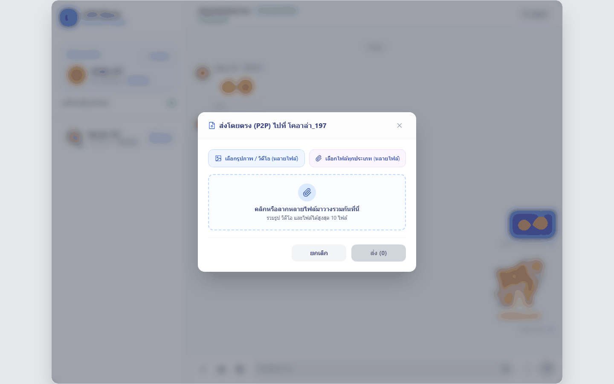
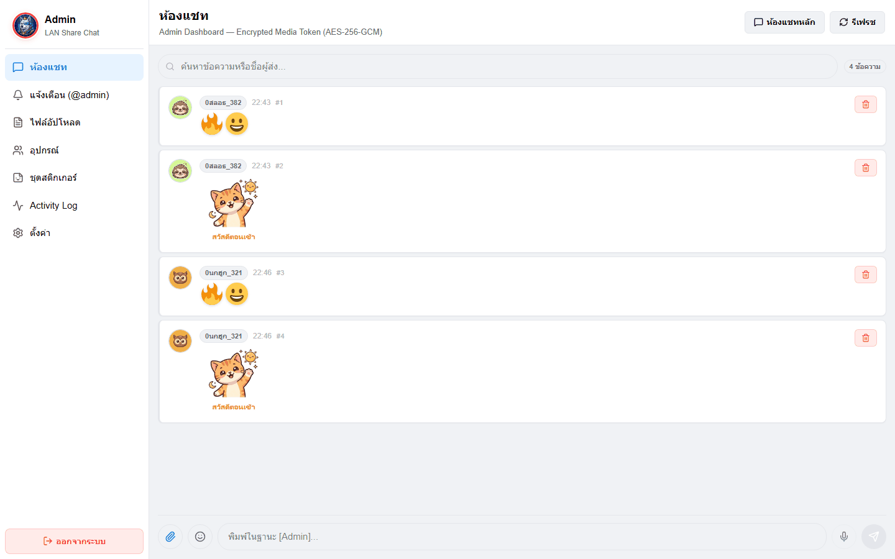
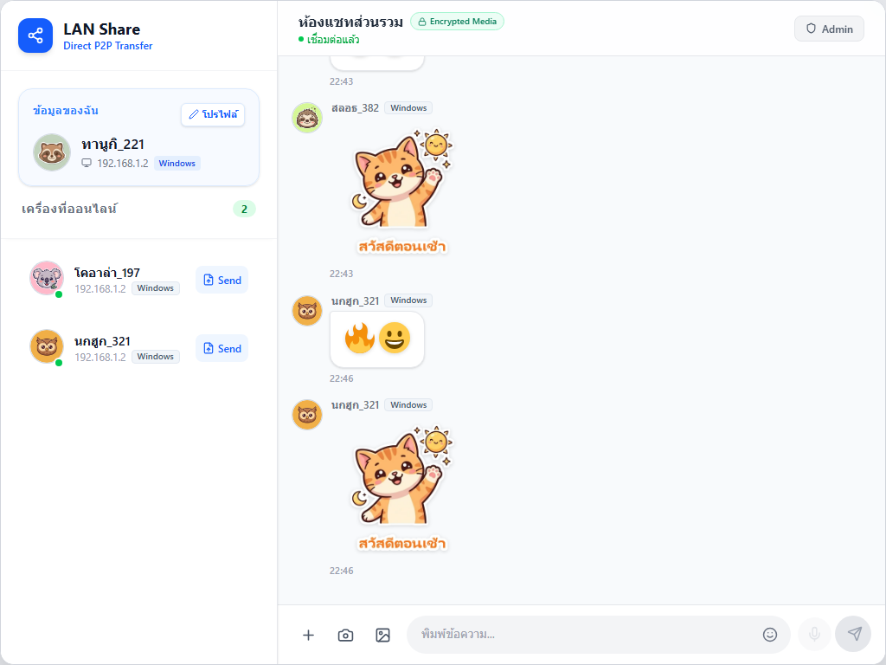
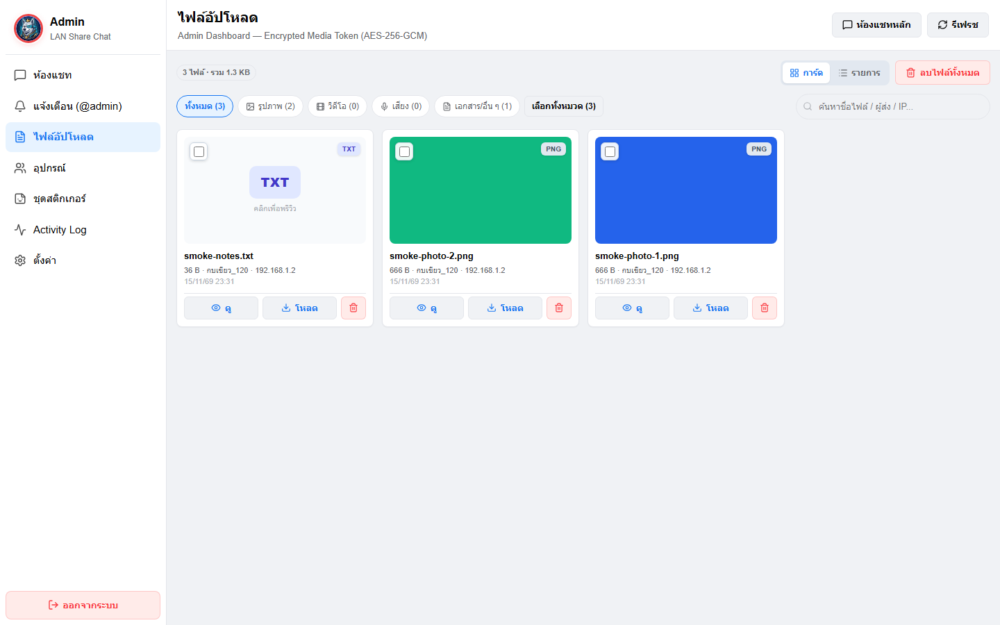
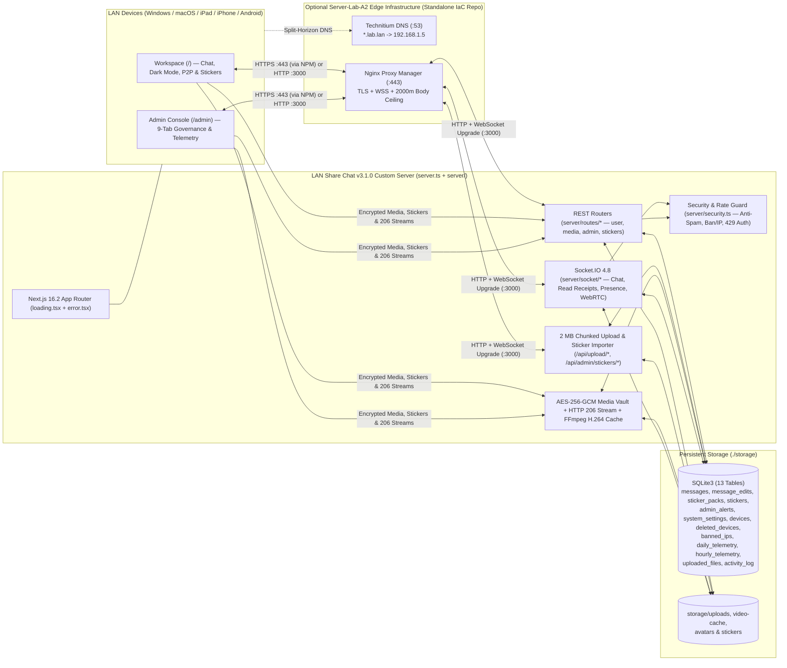

# LAN Share Chat v3.2.0

> High-speed LAN group workspace featuring **Dual-SQLite Bulkhead (`database.sqlite` + `control_plane.sqlite`) & `0.1ms` In-Memory Emergency Gate**, **Dynamic Adaptive Media Worker Queue (`MEDIA_WORKER_CONCURRENCY=auto`)**, **Unified Lossy WebP Poster & Bidirectional Viewport Gate (`SecureImage` / `SecureVideo` / `.gif` Stickers)**, **Auto-Dynamic Browser LRU Blob Cache**, **Auto Reverse Infinite Scroll with Discord-style Unread Divider & Jump to Present**, **macOS Finder Gallery-Style File Preview (`< / >` + Collapsible Bottom Filmstrip)**, **300ms Coalesced Admin Socket Batching**, **Direct WebRTC P2P transfer with automatic ACK-controlled Secure Relay fallback**, **1 GB (`1024 MB`) chunked uploads driven by `.env` Single Source of Truth**, **AES-256-GCM Encrypted Media Vault**, and **Bilingual (`TH` / `EN`) + Dark Mode + Ultrawide Adaptive UI**.

[](https://nextjs.org/)
[](https://www.typescriptlang.org/)
[](https://socket.io/)
[](https://www.sqlite.org/)
[](Dockerfile)
[](LICENSE)

---

## What's New in v3.2.0

Full release notes: [`RELEASE_NOTES_v3.2.0.md`](RELEASE_NOTES_v3.2.0.md)

- **Dual-SQLite Bulkhead + In-Memory Control Plane Gate (`0.1ms`):** Separates write-heavy chat/media traffic (`database.sqlite`) from admin control state (`control_plane.sqlite`) with automatic one-time migration on startup. Emergency actions (`Spotlight`, `Lock Public Chat`, `Privacy Blur`) stay responsive (`~10ms`) even under active bot/video floods.
- **Dynamic Adaptive Media Worker Queue (`MEDIA_WORKER_CONCURRENCY=auto`):** Auto-detects Docker cgroup/host CPU & RAM (`server/utils/mediaWorkerQueue.ts`) with `< 15%` free-RAM backpressure and `.env` override support, audited live in `/admin` → `.env / ระบบ`.
- **Unified Lossy WebP Poster + Bidirectional Viewport Gate + Auto-Dynamic LRU Cache:** Unmounts off-screen ``, video posters, and animated `.gif` stickers cleanly using persistent real-box observers (`0` layout shift, `0` flicker) and device-aware LRU Blob caps (`URL.revokeObjectURL`) to prevent iPad/mobile Safari OOM crashes.
- **Admin-Configurable `.gif` Sticker Picker Mode (`stickerPickerGifMode`):** Switch between **`live_viewport`** (default: animates only visible tiles in viewport) and **`static_poster`** (serves compact Lossy WebP first-frame `?poster=1`, animates on hover/send).
- **Expanded Sticker Collage Stage (`DockedStickerPreviewTray.tsx`):** Widened interactive collage canvas to fill the docked dark preview tray cleanly.
- **Auto Reverse Infinite Scroll + Discord-Style Unread Divider & Jump to Present:** Automatically loads older history pages (`GET /api/messages/page`, `GET /api/admin/messages?limit=60`) on top scroll with scroll-position anchoring (`useChatScrollPagination.ts`), never yanks the viewport down while reading older messages, tracks `lastReadMessageId`, and adds `300ms` coalesced Admin Socket batching + one-click **Resolve All Alerts**.
- **macOS Finder Gallery-Style File Preview (`filePreviewer.tsx` + `PreviewFilmstripBar.tsx`):** Adds floating `<` / `>` navigation arrows, keyboard `←` / `→` / `Esc` shortcuts, and a collapsible bottom thumbnail filmstrip across Admin Files and Admin Chat media.
- **Synchronous Atomic Anti-Spam / Anti-Bot Firewall & Server-Side `HTTP 423` API Locks (`server/security.ts`, `mediaRoutes.ts`, `userRoutes.ts`):** Eliminates async SQLite race conditions with an in-memory fast-mute gate, inhuman bot-cadence detection (`>= 6` actions in `< 0.8s`), file/video-upload burst counting (catches rapid uploads even with `Text = 0`), and strict server-side `HTTP 423 Locked` enforcement on all HTTP write/upload/edit APIs & Socket.IO when locked or blurred.
- **Surgical Admin Chat Cleanup Suite (`AdminChatPurgeModal.tsx`, `moderationPurgeRepo.ts`):** Adds **Time-Range Purge** (custom DateTime start/end + quick presets + live preview count), **Multi-User / Group Purge**, and **Smart Bot/Spam Auto-Purge** (scans spam alerts, auto-mutes & burst heuristics to wipe bot spam while preserving 100% of normal human conversation).

---

## Live Interactive Walkthroughs

| Chat, Unified Twemoji & Shared Stickers | Direct WebRTC P2P & Secure Relay | Admin Governance & Visual Vault |
| :---: | :---: | :---: |
|  |  |  |
| Unified Cross-OS Twemoji SVG picker, 16-item transparent sticker pack, Dual-Mode Pre-Send Preview & Sticker Collage Studio | Peer discovery with stacked OS badges, direct WebRTC chunked transfer, and 3.5s ACK-controlled Relay failover | 9-Tab Admin Console with Overview Telemetry, Visual Grid/List Vault, Batch Delete/Purge, Read-Only `.env` Audit & Sticker Studio |

### Multi-Viewport Snapshots

| Desktop (`1440×900`) | iPad Landscape (`1024×768`) | Mobile Portrait (`390×844`) | Admin Visual Media Vault (`/admin?tab=files`) |
| :---: | :---: | :---: | :---: |
|  |  |  |  |

---

## Key Capabilities

### Workspace, Adaptive Layout, Themes & Messaging (`/`)
- **Ultrawide-Aware Adaptive Shell (`.ultrawide-shell` / `.ultrawide-card`):** Automatically renders edge-to-edge full screen on standard `16:9` desktops, laptops, tablets, and phones while centering a framed `1280px` workspace card on ultrawide monitors (`aspect-ratio >= 2/1` and `min-width: 1600px`).
- **Dark Mode (`🌙 / ☀️`) & Bilingual (`🌐 TH / EN`) Toggle:** Per-device light/dark theme switcher (`lan_chat_theme`) and instant Thai/English UI switcher (`lan_chat_lang`).
- **Unified Cross-OS Twemoji (`public/emoji/twemoji/*.svg`):** Self-hosted offline Twemoji SVG assets (`0%` CDN dependency) with jumbo scaling for `1–3` pure emoji bubbles—identical appearance across **Windows**, **iOS/iPadOS**, **Android**, **macOS**, and **Linux**.
- **Shared-Room Stickers, Dual-Mode Pre-Send & Collage Studio:**
  - Ships with the 16-item Thai cartoon mascot pack (`starter-office-animals`), `[ 😊 | 🎨 ]` toggle pill, keyword search, `🕒` recent history, draggable/expandable picker drawer, and per-device tray customization (`⚙️`).
  - **Admin-Configurable Pre-Send Modes (`stickerPreviewMode`):**
    1. **Mode 1 (`fullscreen_modal`):** Translucent full-screen zoomable preview with pinch/pan/wheel zoom (`ZoomableMediaStage`), floating zoom rail, and **`ยกเลิก` / `กดส่งสติ๊กเกอร์`** confirmation buttons.
    2. **Mode 2 (`docked_tray`):** Translucent overlay tray anchored directly above the composer input bar (`absolute bottom-full` — zero chat scrollbar jump on Windows, iPad, or mobile), supporting instant 1-tap sticker swapping while keeping the sticker grid open below.
  - **Interactive Sticker Collage Studio (`stickerCollageEnabled`):** Long-press any sticker or click **`ผสมสติกเกอร์ (+)`** in Mode 2 to arrange up to **`6` stickers** side-by-side on a shared canvas with per-layer drag positioning, corner-handle scale + rotation (`⤢`), two-finger pinch/rotate on touchscreens, mouse-wheel zoom on desktop, and crisp multi-layer rendering in both chat bubbles and `StickerZoomModal` (`StickerVisual.tsx`).
- **Pinch-to-Zoom Media & Sticker Viewers (`ZoomableMediaStage.tsx`):** Both photo lightboxes (`LightboxModal`) and sent sticker inspection (`StickerZoomModal`, view-only with no download button) support two-finger pinch-to-zoom, drag panning, mouse-wheel zoom, double-tap toggle, and a floating vertical zoom rail.
- **Live Room Read Receipts (`✓ ส่งแล้ว` → `✓✓ อ่านแล้ว`):** Marks sender messages read when at least one other active participant with a visible tab views `/`. Admin actions inside `/admin` never mark public messages as read.

### Direct P2P, Media Vault & Platform Detection
- **Direct WebRTC P2P + Automatic Secure Relay:** Transfer files directly between LAN peers (`16 KB` WebRTC DataChannel chunks with `64 KB` backpressure threshold) with automatic 3.5s failover to ACK-controlled Socket.IO Secure Relay (`32 KB` chunks).
- **Single Source of Truth Limits (`.env` -> `GET /api/config`):** Configure `MAX_CHAT_FILE_SIZE_MB` and `MAX_P2P_FILE_SIZE_MB` (default `1024 MB` / `1 GB`) in `.env`; files larger than `2 MB` or multi-file batches upload via `2 MB` binary chunks (`POST /api/upload/chunk`).
- **20+1 Circular Avatar Pack & Cropper:** Assigns unused circular animal presets automatically (`public/avatars/*.webp`) and includes pan/zoom circular cropping (`POST /api/profile/avatar`). Admins exclusively hold `admin-special.webp` and `adminRingColor`.
- **AES-256-GCM Vault + Netflix NIO Thumbnail Queue (`POST /api/media/thumb`) + Rich Previews:** Blocks raw static `/uploads/*` access (`HTTP 403`), generates `<= 360px` JPEG thumbnails via a bounded FFmpeg worker queue (`MAX_FFMPEG_WORKERS <= 4`) with in-flight deduplication and 6-slot client concurrency (`0` `<video>` elements rendered in grids), fixes per-token `H.265/HEVC -> H.264` fallback in `CustomVideoPlayer`, enforces a cross-platform `<= 112`-char `fileNameGuard` across sender/HTTP/P2P/download layers, and previews `PDF`, `DOCX`, `Markdown`, `ZIP`, `HEIC`, and XSS-isolated code/HTML in memory.

### 9-Tab Admin Governance, Security & Telemetry Console (`/admin`)
1. **`ภาพรวมระบบ` (Overview Dashboard):** Live server uptime, active/online peer count, 24-hour today peak-concurrency bar chart (`hourly_telemetry`), and 30-day peak/message/per-file-upload/`uploadBytes`/`egressBytes`/spam summary (`daily_telemetry`) — storing only anonymous aggregate counts (`0` PII).
2. **`ห้องแชท` (Chat Moderation):** Messenger-style moderation feed with Spotlight Hold (`adminHoldActive`), Room Freeze (`chatLocked`), Public Chat Privacy Blur (`chatBlurred`), checkbox multi-select batch delete (`POST /api/admin/messages/batch-delete`), per-user **`กวาดสแปม`** (`15 นาทีล่าสุด` / `ทั้งหมดของคนนี้`), inline **`Mute / ปลด Mute`** & **`Ban / ปลดแบน`**, and clickable video poster modals.
3. **`แจ้งเตือน (@admin)` (Admin Alerts):** Real-time alerts for `@admin` / `#help` mentions, post-window delete requests, and automatic `security_spam` incidents.
4. **`ไฟล์อัปโหลด` (Visual Media Vault):** Grid/List switcher, category filters, inline encrypted previews, and multi-select batch delete (`POST /api/admin/files/batch-delete`).
5. **`อุปกรณ์` (Device & IP Governance):** Live presence (`online`/`idle`/`offline`), search + online/restricted filters, inline rename, random alias generator, `Mute`, `แบน` (device ban), two-tone Red+Violet **`แบน+IP`** (`banned_ips`), and device deletion (`deleted_devices`).
6. **`ชุดสติกเกอร์` (Sticker Studio):** Export `.zip` template, import single or multi-`.zip` / folder / image packs (`1–40` items per pack, `16` recommended), batch enable/disable/flip-toggle/delete packs (`POST /api/admin/stickers/batch-visibility` & `batch-delete`), and open a centered **Sticker Item Edit Modal** (`StickerItemEditModal.tsx`) with zoom, live image replacement, pack rename, and last-item delete guard.
7. **`Activity Log`:** Searchable 90-day audit trail with human-readable summaries, full JSON payload inspector modal, and **password-confirmed log clearing** (`POST /api/admin/logs/clear`).
8. **`.env / ระบบ` (Read-Only Environment, Runtime & Segregated Storage Audit):** Live read-only audit (`GET /api/admin/env-status`) detecting **Docker Container** vs **Standalone OS** runtime mode, inspecting free/used disk across all **6 isolated storage zones** (`db`, `uploads`, `stickers`, `avatars`, `cache`, `chunks`), enforcing **`MIN_DISK_FREE_MB`** (`HTTP 507` upload guard), offering one-click transient cache cleanup (`POST /api/admin/env-clear-cache`), and verifying `FFMPEG_PATH`, `ADMIN_PASSWORD`, `MEDIA_SECRET`, and upload quotas without exposing secret values.
9. **`ตั้งค่า` (System Settings):** Configure Admin Avatar/Ring Color, Voice MP3, Sticker Pre-Send Mode (`fullscreen_modal` vs `docked_tray`) & Sticker Collage toggle, Delete Policy, Session Conflict Policy (`takeover` / `block` / `multi_allow`), Room Capacity (`maxConcurrentUsers`), Edit Window, Spotlight/Lock/Blur toggles, Anti-Spam thresholds, JSON Backup, standalone custom sticker pack reset, and full **Factory Reset** (restoring settings, clearing telemetry/messages/files, and resetting stickers to the built-in `starter-office-animals` pack).

---

## System Architecture & Cross-Repository Integration

> **Cross-Repository Architecture (`lan-share-chat` ↔ `Server-Lab-A2`):**  
> `LAN Share Chat v3.1.0` is an independent application repository that can run standalone on any machine (`http://localhost:3000`) **or** integrate over the LAN with **[`Server-Lab-A2`](../Server-Lab-A2)**—our standalone Infrastructure-as-Code (Docker Compose, Technitium Split-Horizon DNS, Nginx Proxy Manager, Internal PKI, Uptime Kuma, and Dozzle) repository. `Server-Lab-A2` does **not** bundle or build `lan-share-chat` inside its repo; instead, Technitium DNS resolves `chat.lab.lan` (and optional LoadGen `bot.lab.lan`) to the `Server-Lab-A2` host (`192.168.1.5`), where Nginx Proxy Manager terminates `365`-day wildcard TLS (`*.lab.lan`), upgrades `Socket.IO` WebSockets, enforces a `2000m` (`2 GB`) body ceiling for `1 GB` chunked uploads, and proxies traffic to `lan-share-chat:3000`.



---

## Quick Start

### Option 1: Docker Compose (Recommended)

```bash
cp .env.example .env
# Edit ADMIN_PASSWORD and MEDIA_SECRET (64-char hex) before production use
docker compose up -d --build
```

Open `http://localhost:3000` (or route behind **`Server-Lab-A2`** Nginx Proxy Manager at `https://chat.lab.lan` to unlock HTTPS Secure Context features: Microphone Voice Notes, Webcam Capture, Clipboard Paste, and PWA install).

### Option 2: Local Node.js (Windows / macOS / Linux)

```bash
npm install
cp .env.example .env
npm run build
npm run start
```

> **Development mode:** Run `npm run dev` to launch `server.ts` + Next.js with hot reload.
>
> **Windows / Standalone Portable Cleanup (Optional):** After `npm run build`, if deploying as a lightweight runtime folder without dev/debug tools, run `npm run clean:portable` to prune `devDependencies`, `.next/dev`, `.next/cache`, and transient `video-cache` / `chunks` while keeping `storage/db`, `uploads`, `stickers`, and `avatars` intact. (Run `npm install` again before future `npm run build` updates.)

### System Requirements & Optional FFmpeg Setup

- **Node.js 24 LTS** (Docker image uses multi-stage `node:24-bookworm-slim`; supports Node 22 LTS+ locally) and **SQLite3** (installed via `npm install`).
- **FFmpeg (Recommended for H.265 / HEVC Video Previews):**
  - **Docker:** Included automatically in [`Dockerfile`](Dockerfile).
  - **Standalone Windows / macOS / Linux:** Install FFmpeg via your OS package manager (`winget install Gyan.FFmpeg` / `brew install ffmpeg` / `apt install ffmpeg`) and ensure `ffmpeg` is on `PATH`, **or** set `FFMPEG_PATH=...` in `.env` and restart the server.
  - Original uploaded files in `storage/uploads/` are never modified; when FFmpeg is present, browser-incompatible codecs (`H.265/HEVC`) are lazily cached as H.264 previews in `storage/video-cache/`. When FFmpeg is absent, `/admin` → `.env / ระบบ` highlights the status in read-only mode.

---

## Documentation Guide

Detailed guides are organized inside [`docs/`](docs/):

1. **[Features & User Guide](docs/01-features-and-user-guide.md)** — Walkthrough of Ultrawide & Dark Mode Workspace, Dual-Mode Sticker Pre-Send & Collage Studio, Zoomable Media Viewers, Read Receipts, P2P Transfer, Safe File Previews, and all **9 Admin Tabs**.
2. **[Architecture & Security](docs/02-architecture-and-security.md)** — Modular backend structure, Cross-Repository Integration with `Server-Lab-A2`, complete **13-table SQLite schema**, AES-256-GCM vault, Session Conflict & Capacity guards, and Companion LoadGen v2 (`tools/loadgen-docker/`).
3. **[Deployment & Configuration](docs/03-deployment-and-configuration.md)** — Environment variables (`.env`), Docker volume layout, and Reverse Proxy integration with `Server-Lab-A2` (`https://chat.lab.lan`).
4. **[Troubleshooting & Mobile Quirks](docs/04-troubleshooting.md)** — Practical fixes for Reverse Proxy `client_max_body_size`, iOS/iPadOS Safari (`HEIC`, `MOV`, PDF Canvas), Android keyboard paste, HTTPS Secure Context, and Docker builds.

---

## License & Attribution

- Application code released under the [MIT License](LICENSE).
- Unified emoji SVG artwork is powered by **Twemoji** ([jdecked/twemoji](https://github.com/jdecked/twemoji) — graphics licensed under [CC-BY 4.0](https://creativecommons.org/licenses/by/4.0/), code under MIT) and bundled locally in `public/emoji/twemoji/`.
- Built-in animal avatars (`public/avatars/`) and starter Thai animal stickers (`public/stickers/starter-office-animals/`) are original AI-generated assets included cleanly for offline LAN usage.
