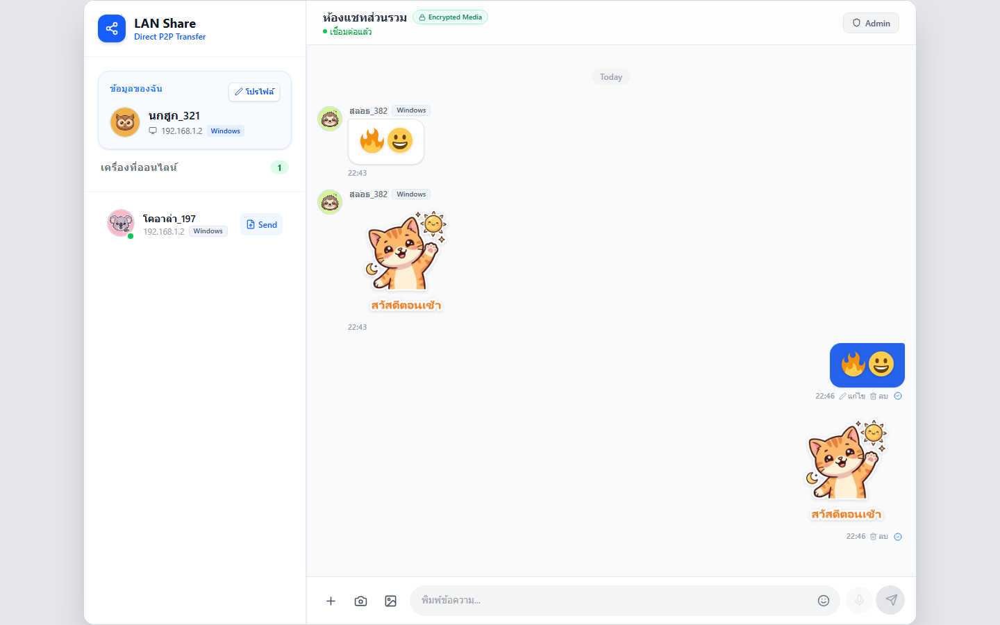
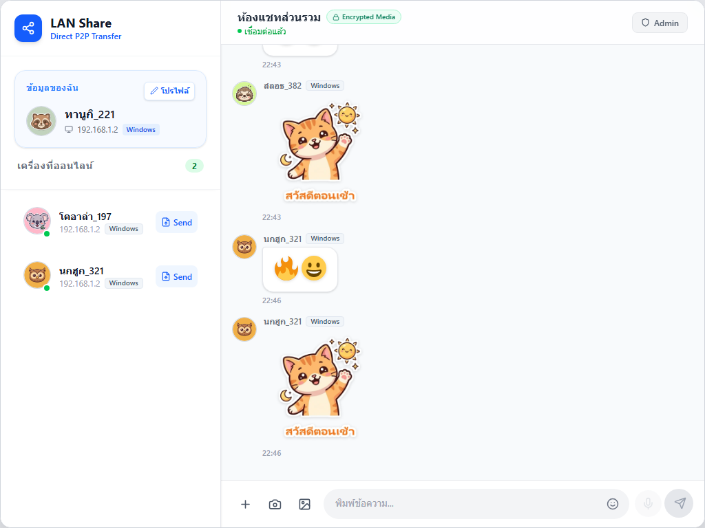
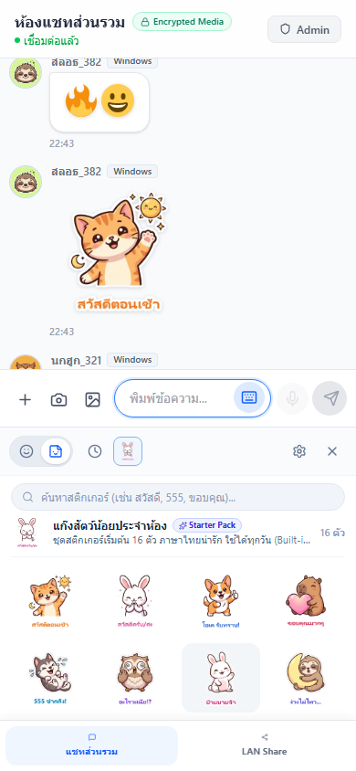
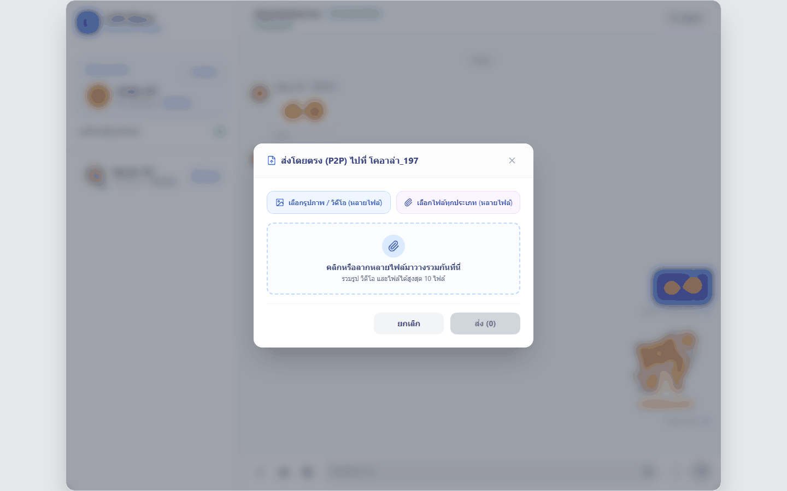
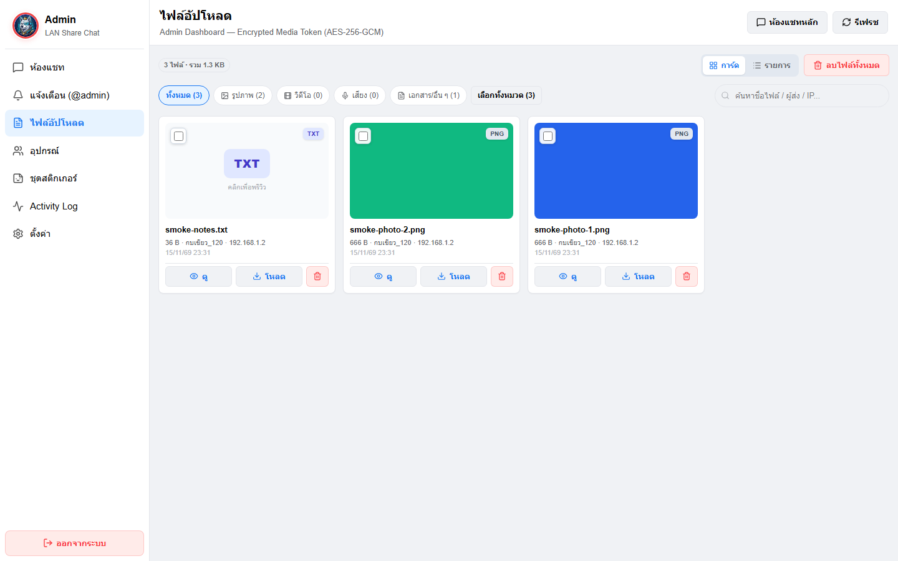

# Features & User Guide

Comprehensive guide to all user and administrator workflows in **LAN Share Chat v3.1.0**.

> **What's New in v3.1.0:**
> - **Netflix NIO Media Grid & Windowing:** Displays 24 cards per scroll step in Admin Files (`0` `<video>` tags in grids), fetching `<= 360px` JPEG posters from `POST /api/media/thumb` with 6-slot browser queueing.
> - **Cross-Platform `<= 112`-Char Filename Guard:** Validates filenames across sender UI (chat, admin, P2P), HTTP chunk upload, WebRTC signaling (`INVALID_FILENAME`), and client downloads to prevent Windows/Linux/Android/iPad path failures.
> - **Mobile Root Back-Guard & History Replace:** Cleanly unwinds modals/lightbox/Peers sub-tab on hardware Back, prevents `/admin` history bounce via `<Link href="/" replace>`, and surfaces a clear top-level root notice.
> - **Traffic Telemetry & Per-Zone Storage Quotas:** Tracks `uploadBytes`, `egressBytes`, and per-file upload counts alongside per-zone quota bars and automatic LRU cache eviction.

---

## 1. Multi-Platform Live Workspace (`/`)

### Adaptive Ultrawide Shell, Peer Discovery, Device Badges & Dark Mode
- **Ultrawide-Aware Viewport Shell (`.ultrawide-shell` / `.ultrawide-card`):** Renders full-bleed edge-to-edge on standard `16:9` desktops, laptops, tablets, and mobile screens while centering a framed `1280px` workspace card on ultrawide monitors (`>= 2:1` aspect ratio and `>= 1600px` width).
- **Automatic Animal Identity & OS Badges:** Upon opening `/`, each browser receives a persistent `deviceId` and an **unused animal preset alias + circular avatar** (`นกเพนกวิน`, `คาปิบาร่า`, `ชิบะอินุ`, `กระรอกบิน`, etc.). Client User-Agent & platform hints (`src/lib/deviceMeta.ts`) automatically tag devices as **`Windows`**, **`iPad`**, **`iPhone`**, **`Android`**, **`macOS`**, **`Linux`**, or **`ChromeOS`**.
- **Per-Device Dark Mode (`🌙 / ☀️`) & Bilingual UI (`🌐 TH / EN`):** Toggle dark slate mode or switch between Thai and English from the main chat header; preferences persist locally in `localStorage` (`lan_chat_theme`, `lan_chat_lang`).
- **Live Read Receipts & Governance Overlays:** Own messages show `✓ ส่งแล้ว` until at least one other participant with a visible `/` tab views the chat (`✓✓ อ่านแล้ว`). When Admin activates **Spotlight Hold**, **Room Freeze (`chatLocked`)**, or **Public Chat Privacy Blur (`chatBlurred`)**, connected clients update instantaneously via Socket.IO.
- **Session Policy & Room Capacity Protection:** Supports Admin-configurable same-IP/OS session conflict handling (**Auto-Takeover**, **Strict Block**, or **Multi-Tab Allow**) and a room concurrency ceiling (`maxConcurrentUsers`, default `100`).
- **Deleted & Banned Sender Clarity:** Deleting a device (`deleted_devices`) removes it from active inventory while preserving historical messages—replacing its avatar with a neutral gray silhouette (`UserX`) and `ถูกลบออกจากระบบ`. Banned devices render a `🚫 ถูกแบน` badge and stay blocked behind `banned-overlay` until unbanned.

| iPad View (`1024×768`) | Mobile Portrait View (`390×844`) |
| :---: | :---: |
|  |  |

---

## 2. Profile Modal & 20+1 Circular Avatar System

- Click **`โปรไฟล์`** on your identity card to open `ProfileModal`.
- Pick any of the **20 circular animal presets** served from `/avatars/01-penguin.webp` – `/avatars/20-lion.webp`, or upload a custom photo using the built-in **Interactive Circular Cropper** (`AvatarCropModal`).
- Cropped avatars are exported as circular PNG data URLs, validated server-side (`POST /api/profile/avatar`, max `2 MB` JSON payload), stored persistently in `storage/avatars/`, and broadcast in real time to all connected peers.

---

## 3. Unified Twemoji, Dual-Mode Sticker Pre-Send, Collage Studio & Camera Composer

- **Unified Cross-OS Twemoji (`UnifiedEmojiText.tsx`):** Emojis typed or selected via the `😊` picker render via self-hosted SVG files (`/emoji/twemoji/*.svg`, CC-BY 4.0 graphics) so Windows, iPad/iPhone, Android, and macOS display identical crisp icons, with jumbo scaling for `1–3` pure emoji messages.
- **Shared-Room Stickers (`EmojiStickerPicker.tsx`):**
  - Switch between **Emoji** and **Sticker** modes with the **`[ 😊 | 🎨 ]`** toggle pill, drag the top handle or click the expand button to resize the drawer, browse **`🕒`** recently used items, or search stickers by Thai/English keywords.
  - Ships with the **16-sticker `starter-office-animals` AI pack** (`public/stickers/starter-office-animals/`).
  - Per-device **`⚙️` Tray Manager** lets each user show/hide or reorder packs locally via `localStorage`.
- **Admin-Configurable Sticker Pre-Send Modes (`stickerPreviewMode`):**
  1. **Mode 1 — Full-Screen Zoomable Modal (`fullscreen_modal`, `StickerPreSendModal`):** Tapping a sticker opens a full-screen translucent preview supporting pinch/wheel/button zoom (`60%–300%`) and bottom **`ยกเลิก`** / **`กดส่งสติ๊กเกอร์`** action buttons.
  2. **Mode 2 — Docked Overlay Tray Above Composer (`docked_tray`, `DockedStickerPreviewTray`):** Tapping a sticker opens a translucent frosted tray anchored directly above the composer input bar (`absolute bottom-full` — **chat scrollbar never jumps** on Windows, iPad, or mobile). Tapping other stickers in the open picker below immediately swaps the preview in place; tapping the previewed sticker or the blue Send button sends it.
- **Interactive Sticker Collage Studio (`stickerCollageEnabled`):**
  - While in Mode 2 (`docked_tray`), **long-press** any sticker in the picker (`360ms`), `Shift+Click` on desktop, or click **`✨ ผสมสติกเกอร์ (+)`** inside the tray to enter Collage Mode.
  - Place up to **`6` stickers** side-by-side on the stage (`aspect-[16/10]`).
  - Tap any placed sticker to reveal its white selection frame with a top-left **`✕`** delete badge and a bottom-right **`⤢`** drag handle that simultaneously **scales (`0.4x–2.2x`) and rotates (`-180°..180°`)** the sticker around its center (also supports two-finger pinch/rotate on touchscreens and mouse-wheel zoom on desktop).
  - Click **Send** to broadcast the multi-layer composition (`stickerMeta.layers`), rendered crisply in chat bubbles and inside the full-screen `StickerZoomModal` (`StickerVisual.tsx`).
- **Expressive Composer & Camera Capture (`ChatComposer.tsx` + `CameraCaptureModal.tsx`):**
  - Action rail provides **`[+]`** (All files), **`[📷]`** (Desktop Webcam snapshot modal or mobile camera), and **`[🖼️]`** (Gallery photos/videos), collapsing cleanly into **`≡ >`** while typing on narrow mobile screens.
  - Supports `contentEditable="plaintext-only"`, clipboard screenshot paste (`Ctrl+V` / Android Gboard), and `@mention` autocomplete.

---

## 4. Direct WebRTC P2P + Automatic Secure Relay

- Click **`Send`** next to any online peer under **`เครื่องที่ออนไลน์`** to initiate a direct peer-to-peer transfer (`up to MAX_P2P_FILE_SIZE_MB`, default `1024 MB` / `1 GB`).
- Uses **`16 KB` WebRTC SCTP DataChannel chunks** with backpressure flow control (`bufferedAmountLowThreshold = 64 KB`).
- If direct WebRTC handshake does not open within **3.5 seconds**, the transfer automatically fails over to **ACK-controlled Socket.IO Secure Relay** (`direct_relay`, `32 KB` chunks) without dropping the session.

---

## 5. Safe Multi-Format In-App Previews & Pinch-to-Zoom Viewers

| Format | Client Engine | Notes |
| :--- | :--- | :--- |
| **Images** (`.jpg`, `.png`, `.webp`, `.gif`, `.bmp`) | AES-256-GCM Blob + `LightboxModal` (`ZoomableMediaStage`) | Album grid + pinch/pan/wheel zoom & floating zoom rail |
| **Sent Stickers & Collages** | `StickerZoomModal` (`ZoomableMediaStage` + `StickerVisual`) | Full-screen pinch/pan/wheel zoom (view-only; no download button) |
| **Apple Photos** (`.heic`, `.heif`) | `heic2any` | Converted cleanly to JPEG/PNG in browser |
| **Videos / Audio** (`.mp4`, `.mov`, `.m4v`, `.webm`, `.mp3`, `.wav`, `.m4a`) | Expiring Stream Ticket (`HTTP 206`) + Optional FFmpeg H.264 Cache | Smooth byte-range seeking on iOS/iPadOS Safari & custom video player |
| **PDF** (`.pdf`) | `pdfjs-dist` `<canvas>` | Multi-page canvas rendering with zoom controls on iOS Safari & desktop |
| **Markdown** (`.md`) | `react-markdown` + `remark-gfm` + `rehype-sanitize` | Rendered safely with GFM tables and code blocks |
| **Word Documents** (`.docx`) | `mammoth` + `dompurify` | Sanitized HTML document preview |
| **ZIP Archives** (`.zip`) | `jszip` | Inspects archive tree & sizes in memory without disk extraction |
| **Active Markup / Code** (`.html`, `.svg`, `.js`, `.ts`, `.json`) | Read-only escaped viewer | Explicitly blocked from DOM/script execution to prevent XSS |

---

## 6. 9-Tab Admin Governance Console (`/admin`)

Accessible from the top-right **`Admin`** header button (protected by single-session token takeover and per-IP `HTTP 429` brute-force rate limiting):

1. **`ภาพรวมระบบ` (Overview Telemetry Dashboard):** Displays live server uptime, active connected peers, a 24-hour today peak-concurrency chart (`hourly_telemetry`), and a 30-day peak/message/upload/spam summary (`daily_telemetry`) plus quick toggles for **Admin Hold Spotlight**, **Room Freeze**, **Public Chat Blur**, **Anti-Spam**, and **Voice Notes**.
2. **`ห้องแชท` (Chat Moderation & Batch Purge):** Messenger-matched feed, checkbox multi-select + **`ลบที่เลือก (N)`** (`POST /api/admin/messages/batch-delete`), per-user **`กวาดสแปม`** (`15 นาทีล่าสุด` / `ทั้งหมดของคนนี้`), inline **`Mute / ปลด Mute`** and **`Ban / ปลดแบน`**, sender state pills (`🚫 ถูกแบน`, `🌐🚫 แบน+IP`, `⏳ ถูก Mute`, `🗑️ ถูกลบแล้ว`), and Admin chat/sticker/collage sending.
3. **`แจ้งเตือน (@admin)` (Admin & Security Alerts):** Real-time cards for `@admin` / `#help` mentions, post-window delete requests (with 1-click **Approve & Delete**), and `security_spam` auto-mute incidents.
4. **`ไฟล์อัปโหลด` (Visual Media Vault):** Switch between **`⊞ การ์ด` (Grid)** and **`☰ รายการ` (List)** views, filter by category or keyword, preview encrypted media inline, batch-delete selected files (`POST /api/admin/files/batch-delete`), or download selected files as a streamed `.zip`.
5. **`อุปกรณ์` (Device & IP Governance):** Sorted Online → Idle → Offline with search and status filters, inline rename + random animal alias generator, `Mute`, `แบน` (device ban), two-tone Red+Violet **`แบน+IP`** (`banned_ips`), and single-device removal (`deleted_devices`).
6. **`ชุดสติกเกอร์` (Sticker Studio):** Download a **Template `.zip`**, import single or multi-`.zip` archives, folders, or image batches (`1–40` items per pack, `16` recommended), multi-select packs for **Batch Enable / Disable / Flip-Toggle / Delete**, reorder packs, and open the centered **Sticker Item Edit Modal** (`StickerItemEditModal.tsx`) to zoom, replace an individual sticker's image live, edit `alt`/keywords, or rename the pack.
7. **`Activity Log`:** Searchable & category-filterable 90-day audit trail with human-readable summaries, a JSON payload inspector modal, and **password-confirmed log clearing** (`POST /api/admin/logs/clear`).
8. **`.env / ระบบ` (Read-Only Environment & FFmpeg Audit):** Inspects `FFMPEG_PATH` / system FFmpeg availability, `ADMIN_PASSWORD`, `MEDIA_SECRET`, writable storage directories, and runtime upload limits in read-only mode (`GET /api/admin/env-status`).
9. **`ตั้งค่า` (System Settings & Granular / Factory Reset):** Configure Admin Avatar & Ring Color, Voice MP3 toggle, **Sticker Pre-Send Mode (`แบบ 1: เต็มจอซูมได้` vs. `แบบ 2: แถบเหนือช่องพิมพ์ + ผสม`)**, **Sticker Collage toggle**, Delete Policy, Session Conflict Policy (`takeover` / `block` / `multi_allow`), Max Concurrent Users (`0–1000`), Edit Window minutes, Anti-Spam thresholds, JSON Backup, standalone **Reset Uploaded Sticker Packs**, and **Factory Reset (`⚠️ รีเซ็ตทั้งหมด`)** which restores default settings, clears messages/files/telemetry, and resets stickers back to only the built-in `starter-office-animals` pack.
